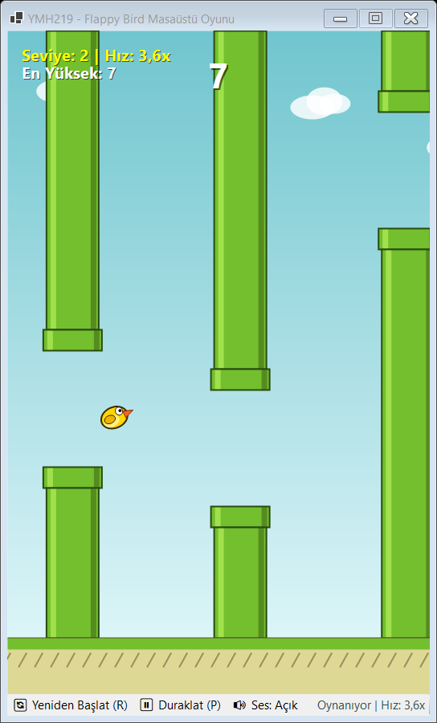
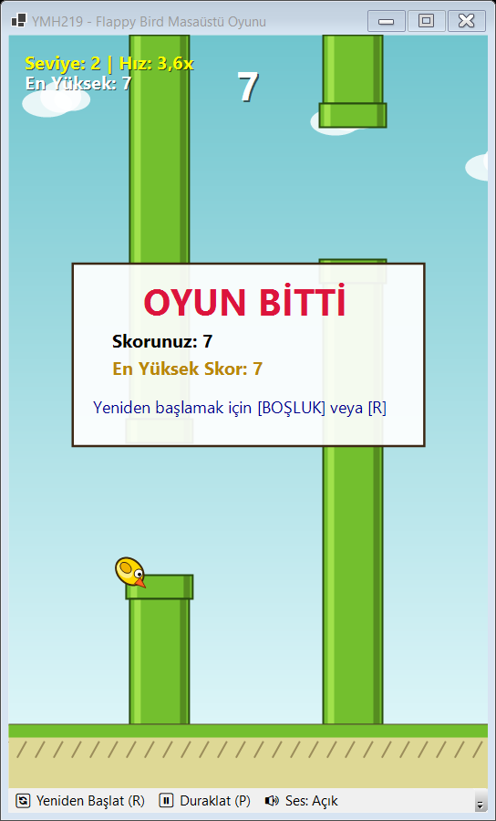

# YMH219 - Flappy Bird Masaüstü Oyunu

Bu proje, Fırat Üniversitesi Nesne Tabanlı Programlama (YMH 219) dersi kapsamında geliştirilmiş bir Flappy Bird benzeri masaüstü oyunudur. C# ve Windows Forms teknolojileri kullanılarak nesne yönelimli programlama (OOP) prensiplerine uygun şekilde tasarlanmıştır.

---

## 📌 Projenin Amacı ve Kısa Açıklama

Projenin amacı; Windows Forms üzerinde zamanlayıcı (Timer) döngüsü, klavye olayları (KeyDown), nesne tabanlı durum yönetimi, yerçekimi ve çarpışma algoritmalarının uygulanmasıdır. Oyunda kuş karakteri yerçekimi etkisiyle aşağı düşerken, oyuncu klavyeden tuşlara basarak kuşu zıplatır ve boruların arasından geçmeye çalışır.

---

## 🛠️ Kullanılan Teknolojiler

- **Programlama Dili:** C# (.NET 10.0 / Windows Forms)
- **Oyun Döngüsü:** `System.Windows.Forms.Timer` (yaklaşık 55 kare/saniye)
- **Çizim ve Grafik:** GDI+ (`System.Drawing`), çift arabellekleme (double buffering)
- **Ses:** `Console.Beep` (arka plan görevinde çalınan kısa tonlar)
- **Harici NuGet paketi:** Yok
- **Sürüm Kontrolü:** Git & GitHub

---

## 🚀 Kurulum ve Çalıştırma Adımları

### Gereksinimler
- Windows 10 veya Windows 11
- [.NET 10 SDK](https://dotnet.microsoft.com/download/dotnet/10.0)
- Visual Studio 2026 (".NET masaüstü geliştirme" iş yükü) **veya** komut satırı için yalnızca .NET 10 SDK

> Proje `net10.0-windows` hedeflediği için Visual Studio 2022 ile açılamaz.

### Çalıştırma
1. Projeyi bilgisayarınıza klonlayın veya zip olarak indirin:
   ```bash
   git clone https://github.com/BirgulGokturk/YMH219-FlappyBird.git
   cd YMH219-FlappyBird
   ```
2. Projeyi terminal üzerinden derleyip çalıştırın:
   ```bash
   dotnet build
   dotnet run
   ```
   *Veya `YMH219_FlappyBird.sln` dosyasını Visual Studio ile açarak F5 tuşu ile başlatabilirsiniz.*

---

## 🎮 Kontroller ve Oynanış

- **Boşluk (Space) / Yukarı Ok (↑):** Zıpla / Oyunu Başlat / Oyun bittikten sonra yeniden başlat
- **R Tuşu:** Oyunu Yeniden Başlat (Restart)
- **P Tuşu:** Oyunu Duraklat / Devam Ettir (Pause)
- **M Tuşu:** Sesleri Aç / Kapat (Mute)
- Alt çubuktaki butonlarla da yeniden başlatma, duraklatma ve ses açma/kapama yapılabilir.

Kuş çarptıktan sonraki 0,6 saniye içinde basılan Boşluk/Yukarı Ok yok sayılır; böylece oyuncu çarpma anında tuşa basıyorsa oyun "Oyun Bitti" ekranı görünmeden yeniden başlamaz. R tuşu her zaman hemen yeniden başlatır.

---

## ⚙️ Uygulamanın Temel Özellikleri

- **Nesne Yönelimli Mimari:** Kuş (`Bird`), boru çifti (`PipePair`), oyun durumu (`GameState`), oyun motoru (`GameEngine`), skor yönetimi (`ScoreManager`) ve sesler (`SoundManager`) ayrı sınıflar olarak kodlanmıştır.
- **Yerçekimi ve Zıplama Fiziği:** Kuşun hızına göre dinamik dönüş açısı ve kanat çırpma animasyonu bulunmaktadır.
- **Dinamik Engel Üretimi:** Ekranda sağdan sola hareket eden üç boru çifti, ekranın solundan çıktıkça sağ tarafta rastgele yüksekliklerle yeniden konumlandırılır.
- **Çarpışma Kontrolü:** Kuşun borulara veya zemine çarpması durumunda oyun durur ve "Oyun Bitti" ekranı gösterilir.
- **Skor ve En Yüksek Skor (High Score):** Geçilen her boru için 1 puan verilir. En yüksek skor `highscore.txt` dosyasına kaydedilir ve oyun tekrar açıldığında korunur.
- **Kademeli Hızlanma:** Her 5 puanda seviye artar ve boruların hızı kademeli olarak yükselir.
- **Ekran Ölçeğine Uyum:** Başlangıç ve "Oyun Bitti" kutularının genişliği içindeki yazıya göre hesaplanır; Windows ekran ölçeği (%125, %150) büyüdüğünde yazılar kutudan taşmaz.
- **Kaynak Yönetimi:** Skor/başlık yazı tipleri ve fırçalar her karede yeniden oluşturulmaz; `GameEngine` `IDisposable` olarak bunları oyun kapanırken serbest bırakır.
- **Çift Arabellekleme (Double Buffering):** Ekrandaki titremeleri (flicker) önlemek için form çift arabellekleme ile çizdirilmektedir.

---

## 📸 Ekran Görüntüleri

| Başlangıç / Oyun İçi | Oyun Bitti (Game Over) |
|:---:|:---:|
|  |  |

---

## 🏗️ Nesne Tabanlı Mimari

```
YMH219-FlappyBird/
├── Engine/
│   └── GameEngine.cs     # Oyun döngüsü, çarpışma, skor/seviye, durum yönetimi ve çizim
├── Models/
│   ├── Bird.cs           # Kuşun konumu, yerçekimi/zıplama fiziği ve çizimi
│   ├── PipePair.cs       # Üst-alt boru çifti, hareket ve çarpışma sınırları
│   └── GameState.cs      # Ready, Playing, Paused, GameOver durumları (Enum)
├── Services/
│   ├── ScoreManager.cs   # Mevcut/en yüksek skor ve highscore.txt okuma-yazma
│   └── SoundManager.cs   # Zıplama, skor ve çarpışma sesleri
├── screenshots/
│   ├── ekran1.png
│   └── ekran2.png
├── Form1.cs              # Timer, klavye olayları ve butonlar
├── Form1.Designer.cs     # Form ve alt durum çubuğu tasarımı
├── Program.cs            # Giriş noktası
├── YMH219_FlappyBird.csproj
└── YMH219_FlappyBird.sln
```

---

## 📝 Bilinen Sınırlamalar / Geliştirme Notları

- Oyun penceresi 460x640 sabit boyutta çalışacak şekilde tasarlanmıştır.
- Sesler `Console.Beep` ile üretildiği için basit tonlardır; bazı bilgisayarlarda (ör. sanal makineler) ses duyulmayabilir.
- `highscore.txt` uygulamanın çalıştığı klasöre (`bin/.../`) yazılır; bu klasör silinirse en yüksek skor sıfırlanır.
- Gelecek versiyonlarda farklı zorluk seviyeleri, arka plan temaları (gece/gündüz modu) ve kuş modelleri eklenebilir.

---

## 👤 Öğrenci Bilgileri

- **Adı Soyadı:** Birgül Göktürk
- **Öğrenci Numarası:** 250541094
- **Ders:** Nesne Tabanlı Programlama (YMH 219)
- **Dönem:** 2026-2027 Güz
