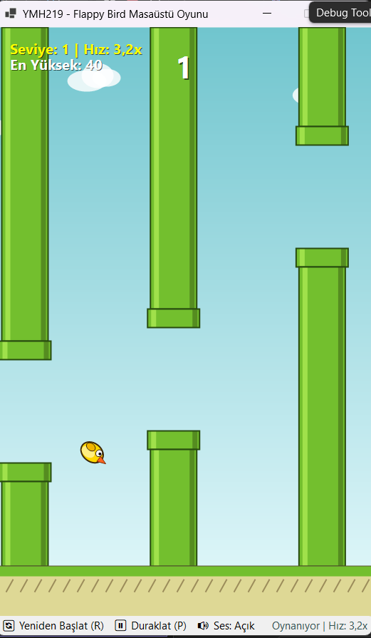
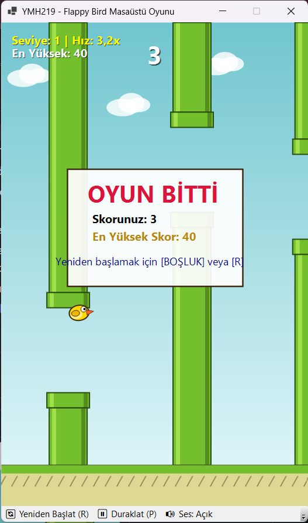

# YMH219 - Flappy Bird Masaüstü Oyunu

Bu proje, Fırat Üniversitesi Nesne Tabanlı Programlama (YMH 219) dersi kapsamında geliştirilmiş bir Flappy Bird masaüstü oyunudur. C# ve Windows Forms teknolojileri kullanılarak nesne yönelimli programlama (OOP) prensiplerine uygun şekilde tasarlanmıştır.

---

## 📌 Projenin Amacı ve Kısa Açıklama

Projenin amacı; Windows Forms üzerinde zamanlayıcı (Timer) döngüsü, klavye olayları (KeyDown), nesne tabanlı durum yönetimi, yerçekimi ve çarpışma algoritmalarının uygulanmasıdır. Oyunda kuş karakteri yerçekimi etkisiyle aşağı düşerken, oyuncu klavyeden tuşlara basarak kuşu zıplatır ve boruların arasından geçmeye çalışır.

---

## 🛠️ Kullanılan Teknolojiler

- **Programlama Dili:** C# (.NET 10.0 / Windows Forms)
- **Geliştirme Ortamı:** Visual Studio / VS Code
- **Çizim ve Grafik:** GDI+ (System.Drawing)
- **Ses Yönetimi:** System.Media / Console Beep
- **Sürüm Kontrolü:** Git & GitHub

---

## 🚀 Kurulum ve Çalıştırma Adımları

1. Projeyi bilgisayarınıza klonlayın veya zip olarak indirin:
   ```bash
   git clone https://github.com/BirgulGokturk/YMH219-FlappyBird.git
   ```
2. Proje dizinine gidin:
   ```bash
   cd YMH219-FlappyBird
   ```
3. Projeyi terminal üzerinden derleyip çalıştırın:
   ```bash
   dotnet build
   dotnet run
   ```
   *Veya `YMH219_FlappyBird.csproj` dosyasını Visual Studio ile açarak F5 tuşu ile başlatabilirsiniz.*

---

## 🎮 Kontroller ve Oynanış

- **Boşluk (Space) / Yukarı Ok (↑):** Zıpla / Oyunu Başlat
- **R Tuşu:** Oyunu Yeniden Başlat (Restart)
- **P Tuşu:** Oyunu Duraklat / Devam Ettir (Pause)
- **M Tuşu:** Sesleri Aç / Kapat (Mute)

---

## ⚙️ Uygulamanın Temel Özellikleri

- **Nesne Yönelimli Mimari:** Kuş (`Bird`), engeller (`PipePair`), oyun motoru (`GameEngine`), skor yönetimi (`ScoreManager`) ve sesler (`SoundManager`) ayrı sınıflar olarak kodlanmıştır.
- **Yerçekimi ve Zıplama Fiziği:** Kuşun hızına göre dinamik dönüş açısı ve kanat çırpma animasyonu bulunmaktadır.
- **Dinamik Engel Üretimi:** Ekranda hareket eden borular sol taraftan çıktıkça sağ tarafta rastgele yüksekliklerle tekrar üretilir.
- **Çarpışma Kontrolü:** Kuşun borulara veya zemine çarpması durumunda oyun durur ve Game Over ekranı gösterilir.
- **Skor ve En Yüksek Skor (High Score):** Geçilen her boru için 1 puan verilir. En yüksek skor `highscore.txt` dosyasına kaydedilir ve oyun tekrar açıldığında korunur.
- **Kademeli Hızlanma:** Skor arttıkça seviye ve boruların geçiş hızı kademeli olarak artar.
- **Çift Arabellekleme (Double Buffering):** Ekrandaki titremeleri (flicker) önlemek için form çift arabellekleme ile çizdirilmektedir.

---

## 📸 Ekran Görüntüleri

<!-- Buraya uygulamanın ekran görüntülerini ekleyebilirsiniz (screenshots klasörüne ekran1.png ve ekran2.png olarak kaydedebilirsiniz) -->

| Başlangıç / Oyun İçi | Oyun Bitti (Game Over) |
|:---:|:---:|
|  |  |

*(Not: `screenshots/` klasörüne `ekran1.png` ve `ekran2.png` isimli ekran görüntülerinizi eklediğinizde yukarıdaki tabloda otomatik olarak görünecektir.)*

---

## 📝 Bilinen Sınırlamalar / Geliştirme Notları

- Oyun penceresi 460x640 sabit boyutta çalışacak şekilde tasarlanmıştır.
- Gelecek versiyonlarda farklı arka plan temaları (gece/gündüz modu) ve kuş modelleri eklenebilir.

---

## 👤 Öğrenci Bilgileri

- **Adı Soyadı:** Birgül Göktürk
- **Öğrenci Numarası:** 250541094
- **Ders:** Nesne Tabanlı Programlama (YMH 219)
- **Dönem:** 2026-2027 Güz
